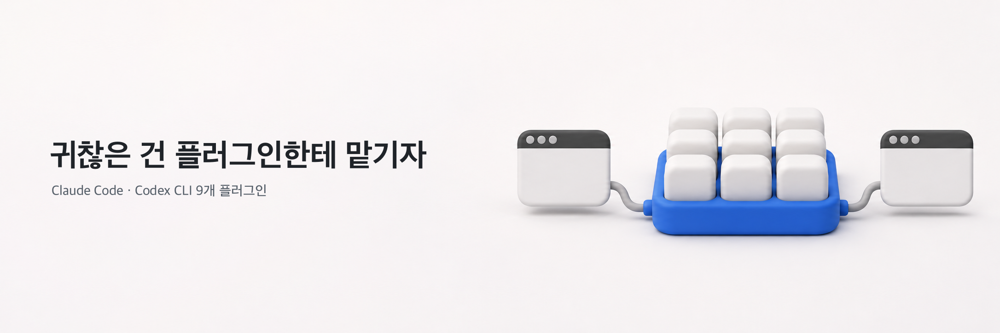
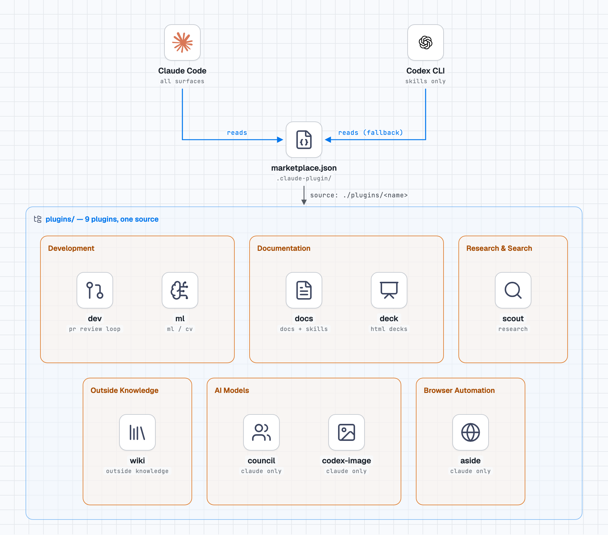

<div align="center">



# my-claude-plugins

Claude Code 용 9개 플러그인 모음. 그중 6개는 Codex CLI 겸용.

[](#플러그인-구성)
[](https://code.claude.com/docs/en/overview)
[](#codex-cli)
[](LICENSE)

</div>

---

PR 리뷰 반영, 리서치, 문서 작성, 강의 덱 제작처럼 손이 많이 가는 일을 슬래시 명령 하나로 위임.

- **리뷰 자동 반영**: `/dev:review-loop` 가 CodeRabbit·Codex 지적을 판정하고 수정해 push. 새 지적이 나오지 않을 때까지 반복하고 남은 지적은 `tbd` 후속 이슈로 정리 (6건 이상이면 지적마다 sub-issue)
- **다음 단계 안내**: `/dev:flow` 가 아이디어부터 머지·정리까지 지금 단계에서 부를 스킬을 제안
- **두 런타임, 한 소스**: Codex CLI 가 `plugins/` 트리와 `.claude-plugin/` 매니페스트를 그대로 사용. 생성 단계·별도 사본 불필요
- **짧은 호출**: 스킬 호출 형식은 `/plugin:skill`. 슬래시 메뉴에서 `/rev` 만 입력해도 `/dev:review-loop` 매칭 (Claude Code 2.1.236 이상)

## 목차

- [플러그인 구성](#플러그인-구성)
- [빠른 시작](#빠른-시작)
- [업데이트](#업데이트)
- [플러그인 상세](#플러그인-상세)
- [Codex CLI](#codex-cli)
- [설치 옵션](#설치-옵션)
- [요구사항](#요구사항)
- [옛 버전에서 옮겨 오기](#옛-버전에서-옮겨-오기)
- [기여하기](#기여하기)

## 플러그인 구성

Claude Code 와 Codex CLI 가 `marketplace.json` 하나와 `plugins/` 트리 하나를 함께 사용. `council`·`codex-image`·`aside` 3개는 Claude 전용.



| 플러그인 | 하는 일 | 대표 명령 |
|---------|--------|-----------|
| `dev` | PR 리뷰 루프·머지·정리, 프로젝트 셋업, Playwright E2E | `/dev:review-loop` |
| `docs` | README·CHANGELOG·배포 문서, 에이전트 지침과 스킬 작성, Google Drive 내보내기 | `/docs:readme` |
| `scout` | GitHub·Hugging Face·웹·공식 문서 병렬 탐색 후 보고서 1개로 통합 | `/scout:research-orchestrator` |
| `ml` | ML·CV 작업 규율, Gradio 데모, 노트북 작성과 편집 | `/ml:cv-notebook` |
| `wiki` | 저장소 밖 지식(플랫폼·벤더·고객·도메인)의 출처 달린 wiki 관리 | `/wiki:ingest` |
| `deck` | house 형식 HTML 강의·보고 덱 조립·검사·배포 | `/deck:deck-ask` |
| `council` | GPT·Gemini·Claude 좌석 3개의 교차 심의 (Claude 전용) | `/council:convene` |
| `codex-image` | OpenAI API key 없이 Codex 로 이미지 생성 (Claude 전용) | `/codex-image:codex-image` |
| `aside` | 로그인된 Aside 브라우저에 웹 작업 위임, 로그인 뒤 같은 세션에서 재개 (Claude 전용) | `/aside:aside` |

## 빠른 시작

marketplace 를 추가하고 필요한 플러그인만 설치하세요.

```bash
# 1. Marketplace 추가
/plugin marketplace add YoungjaeDev/my-claude-plugins

# 2. 필요한 플러그인 설치
/plugin install dev@my-claude-plugins

# 3. 아이디어부터 PR 까지도 맡기려면 Matt 스킬 설치
/plugin marketplace add mattpocock/skills
/plugin install mattpocock-skills@mattpocock

# 4. 다음에 할 일 묻기
/dev:flow
```

정상이면 슬래시 메뉴에 `/dev:` 스킬 목록이 뜨고 `/dev:flow` 가 다음에 부를 스킬을 알려 줍니다. 메뉴에 없으면 Claude Code 를 재시작하세요. 그래도 옛 버전이 뜨면 [업데이트](#업데이트)의 캐시 삭제 절차를 따르세요.

## 업데이트

플러그인 캐시 버그([#17361](https://github.com/anthropics/claude-code/issues/17361), [#19197](https://github.com/anthropics/claude-code/issues/19197)) 때문에 **Auto-update 를 켜도 플러그인 파일은 갱신되지 않으니** 캐시를 지운 뒤 marketplace 를 업데이트하고 Claude Code 를 재시작하세요.

```bash
# 1. 캐시 삭제
#   macOS / Linux:
rm -rf ~/.claude/plugins/cache/my-claude-plugins/
#   Windows (PowerShell):
#   Remove-Item -Recurse -Force "$env:USERPROFILE\.claude\plugins\cache\my-claude-plugins"

# 2. Marketplace 업데이트 후 Claude Code 재시작
/plugin marketplace update my-claude-plugins
```

2.86.0 이전 버전에서 올라온다면 [옛 버전에서 옮겨 오기](#옛-버전에서-옮겨-오기)도 확인하세요.

## 플러그인 상세

<details>
<summary><strong>dev</strong> - PR 리뷰 루프·머지·정리, 프로젝트 셋업, E2E 하네스</summary>

PR 부터 리뷰 루프, 머지, 정리까지 담당. 아이디어부터 PR 까지는 Matt 스킬(`mattpocock/skills`)의 `/grill-with-docs`, `/to-spec`, `/to-tickets`, `/implement-spec`(또는 `/implement`) 순서. 버그 진단은 `/diagnosing-bugs`, 교훈 정리는 빌드한 세션의 `/retro` 담당.

| 분류 | Skill | 하는 일 |
|------|-------|---------|
| GitHub | `/dev:flow` | 다음에 부를 스킬 안내 (Matt 앞단과 dev 뒷단, 버그·E2E·worktree 갈래, 제품 repo 준비). 직접 실행 없는 안내 전용 |
| GitHub | `/dev:commit-and-push` | 변경 분석, Conventional Commits 메시지로 커밋과 푸시 |
| GitHub | `/dev:review-loop` | CodeRabbit·Codex 지적의 자율 판정 (apply / defer / skip) 과 수정, 켜진 리뷰어 전원의 HEAD 판정 대기, 수렴·저심각도 바닥·churn 에서 정지, 남은 지적은 `tbd` 후속 이슈 (6건 이상이면 지적마다 sub-issue), 머지 전 "auto-merge 할까요?" 질문. 상세는 [`SKILL.md`](plugins/dev/skills/review-loop/SKILL.md). `--auto-merge`, `--cr-source <auto\|pr-bot\|cli\|codex-only>` |
| GitHub | `/dev:post-merge` | 머지 후 정리 전용: 남은 리뷰 지적 표시, base 전환, 안전 조건을 통과한 다른 worktree 를 한 번 확인받고 삭제, 브랜치 삭제, 안전 조건을 통과한 원격 브랜치를 한 번 확인받고 삭제, 남은 이슈 close, Project 상태 동기화, About 줄 점검, 커밋 |
| GitHub | `/dev:release` | 버전 태그와 GitHub Release 생성 (릴리스 노트 자동 생성) |
| GitHub | `/dev:session-handoff` | 컨텍스트를 비우기 전 새 에이전트용 인수인계 요약을 채팅에 작성 |
| GitHub | `/dev:orchestrate` | 메인 에이전트의 오케스트레이터 전환: 슬라이스별 job card, 워커 프리셋 `dev:worker-standard/deep/max`, 경로당 writer 1개, 오케스트레이터의 직접 검증. 파일을 쓰는 슬라이스는 worktree 격리. Codex 에는 `Agent` 도구가 없어 인라인 실행 |
| 셋업 | `/dev:new` | 빈 디렉터리에서 인터뷰, `.claude/` 스캐폴드, CLAUDE.md 와 AGENTS.md (general / ml / web), README·CHANGELOG 시드, `gh repo create` 와 초기 푸시까지 처리. 비어 있지 않은 디렉터리는 거부 |
| 셋업 | `/dev:wiring` | 기존 repo 하네스 배선의 14축 진단 (`core.hooksPath`, `.claude/rules` 스코핑을 무력화하는 `@import`, MCP 중복 등록, Codex `AGENTS.md` 바이트 예산 등). 승인 전까지 read-only |
| E2E | `/dev:e2e-setup` | 에이전트 생성, 인증 분리, `page.route` 모킹 스캐폴드, CI 워크플로우 생성. 기존 `playwright.config` 는 덮어쓰지 않고 머지 제안과 백업만 |
| E2E | `/dev:e2e-author` | critical flow 선정, 계획서와 사용자 검토를 거친 스펙 생성, `--repeat-each` 번인 |
| E2E | `/dev:e2e-debug` | 실패한 CI run 의 트레이스 분석, healer 로 최대 3회 수리 후 재실행 |

- **E2E 하네스**: Playwright 공식 AI 에이전트(planner / generator / healer)를 감싼 자가개선 루프. Playwright 가 없으면 graceful degrade
- Codex 에서는 E2E 역할 계약(`references/role-contracts.md`)을 generic subagent 나 순차 실행으로 유지
- **Requirements**: `gh`, `git`, `jq`; E2E 는 Node.js 와 Playwright

제품 repo 준비(repo 당 1회): Matt 스킬을 설치한 뒤 `/setup-matt-pocock-skills` 로 이슈 트래커·triage 라벨·도메인 문서를 연결하고 triage 라벨 5개를 만드세요. 라벨이 없으면 첫 `/to-spec` 부터 실패. 아래 명령은 없는 라벨만 만들기 때문에 다시 돌려도 기존 라벨 유지.

```bash
( have=$(gh label list --limit 1000 --json name --jq '.[].name') || exit 1
  for l in needs-triage needs-info ready-for-agent ready-for-human wontfix; do
    printf '%s\n' "$have" | grep -qxF "$l" || gh label create "$l" || exit 1
  done )
```

</details>

<details>
<summary><strong>docs</strong> - 문서 작성과 내보내기</summary>

| 분류 | 명령 | 하는 일 |
|------|------|---------|
| 프로젝트 문서 | `/docs:readme generate` / `analyze` | 템플릿(CLI, Library, React Component, MCP Plugin, SaaS, Desktop, Internal)으로 README 생성, 기존 README 분석 |
| 프로젝트 문서 | `/docs:changelog init` | Keep a Changelog 형식 CHANGELOG |
| 프로젝트 문서 | `/docs:deploy-doc generate` | 배포·절차 문서 (요약, 전제조건, 번호 단계) |
| 프로젝트 문서 | `/docs:moc docs/` | 문서 폴더 MOC 인덱스 (경량 / `--strict`) |
| 에이전트 문서 | `/docs:write-rules` | CLAUDE.md 와 `.claude/rules/*.md` 를 공식 패턴(200줄 root cap, `paths:` 스코핑)으로 생성·재구조화 |
| 에이전트 문서 | `/docs:interview-methodology` | 작은 요청의 모호한 점 확인, 대화 안 요약으로 마무리 (재사용 프롬프트는 TCREI 형식). 큰 일은 `/grill-with-docs` 로 이관 |
| 에이전트 문서 | `/docs:vp` | 음성 전사 프롬프트 게이트. `.agents/voice-terms.md` 사전으로 오인식 교정, 뜻이 명확하면 진행, 모호하면 질문 2~3개 |
| 에이전트 문서 | `/docs:skill-forge` | Claude Code 와 Codex 양쪽에서 동작하는 스킬 작성·개정 (프론트매터, 작성 레버, 패키징 계약) |
| 에이전트 문서 | `/docs:md-audit` | 사용자 호출 전용. md 문서의 바이트·문단·헤딩·굵은 글씨를 스크립트로 측정하고 채팅으로 보고, 고른 파일만 다시 씀 (스킬 7축 진단 포함) |
| 내보내기 | `/docs:translate-web-article` | 웹 페이지의 한국어 마크다운 번역 (이미지 분석, 코드·테이블 보존) |
| 내보내기 | `/docs:gws-sync` | 로컬 파일의 Google Drive 단방향 동기화 (`gws` CLI). 업로드 위치는 승인 필요, 삭제는 제안만, 파일 ID·공유 링크 유지 |

- 프로젝트 문서 4개는 Claude 전용 command. `doc-guides` 스킬의 참조 카드에서 필요한 섹션만 로드
- `/docs:readme`·`/docs:deploy-doc`·`/docs:moc`·`/docs:write-rules` 가 만드는 문서는 [`writing-standard.md`](plugins/docs/references/writing-standard.md) 의 모양·톤 기준을 따름

</details>

<details>
<summary><strong>scout</strong> - 리서치와 검색</summary>

| Skill | 하는 일 |
|-------|---------|
| `/scout:research-orchestrator` | 리서치 진입점. quick / deep 모드 선택, github / hf / web / docs scout 병렬 실행. synthesis-scout 가 중복 제거·신뢰도 순위·충돌 해소를 거쳐 Markdown 보고서로 통합 |
| `/scout:ask` | DeepWiki MCP 로 GitHub 레포에 질문 |
| `/scout:generate-llmstxt` | 레포의 `llms.txt` 생성 |

- **Agent team (Claude Code 전용)**: `scout:github-scout`, `scout:hf-scout`, `scout:web-scout` (exa·brightdata·insane-search 순서의 4단계 fetch), `scout:docs-scout` (Context7, DeepWiki), `scout:synthesis-scout`
- Codex 에서는 orchestrator 가 generic subagent 나 순차 실행으로 같은 축을 실행
- 정책·시장·역사처럼 코드와 무관한 주제는 `/deep-research` 직접 호출
- **Requirements**: `gh`, `uvx` (hf)

</details>

<details>
<summary><strong>ml</strong> - ML / CV 개발</summary>

| Skill | 하는 일 |
|-------|---------|
| `/ml:ml-dev-principles` | ML·멀티모달 작업 규율: 모델·데이터 선정, EDA, 학습, 평가 하네스, FP/FN 오류 분석, GPU 병렬 패턴 |
| `/ml:gradio-cv-app` | Gradio 컴퓨터 비전 데모 앱 |
| `/ml:cv-notebook` | CV 실험 노트북 작성과 ipywidgets 탐색 모드 |
| `/ml:edit-notebook` | `.ipynb` 편집 (NotebookEdit 만 사용, 출력 보존, 셀 순서 검증) |

</details>

<details>
<summary><strong>wiki</strong> - 바깥 지식 wiki</summary>

저장소가 통제하지 못하는 것(플랫폼, 벤더, 고객, 도메인)의 지식 전용. 결정은 `docs/adr/`, 용어는 `GLOSSARY.md`, 반복 실수는 `/retro` 가 만드는 자동 검사로 분리. 구조는 `.llmwiki/raw/` (손대지 않는 원본)와 `.llmwiki/wiki/` (`index.md`, `log.md`, `## Sources` 가 달린 개념 페이지).

| Skill | 하는 일 |
|-------|---------|
| `/wiki:ingest` | 원본 문서나 작업 중 알게 된 사실의 개념 페이지화, index·log 갱신. `.llmwiki/` 가 없는 저장소에서는 아무것도 만들지 않고 후보만 보고 |
| `/wiki:query` | index, 개념 페이지, raw 순서로 읽고 인용을 단 답변. 새 답은 승인 뒤에만 저장 |
| `/wiki:lint` | 오래된 페이지, 깨진 링크·Sources, 고아 페이지, index 불일치 점검 (read-only) |
| `/wiki:plaud-note-taking` | PLAUD 녹음기 전사록을 프로젝트 용어로 정정해 corrected 와 digest 생성, `/wiki:ingest` 로 전달. 원본은 그대로 보존 |

훅과 스크립트 없이 Claude Code 와 Codex 에서 같은 산문으로 동작.

</details>

<details>
<summary><strong>deck</strong> - house 형식 HTML 강의·보고 덱</summary>

`deck/shell.html` 과 `deck/sections/*.html` 을 GSAP 모션과 함께 1920×1080 덱으로 조립. 규칙 원본과 도구는 플러그인에, 덱 저장소에는 버전 도장이 찍힌 규칙 사본(`.claude/rules/`)과 덱 내용만 보관.

| Skill | 하는 일 |
|-------|---------|
| `/deck:deck-ask` | 지금 상황에 맞는 다음 덱 스킬 제안 (실행 없는 제안 전용) |
| `/deck:deck-new` | 빈 저장소에 덱 템플릿(`templates/decks/`의 `monitor` 또는 `ralphdev-light`, 기본 `monitor`)으로 `deck/` 스캐폴드와 규칙 사본 생성. 강의 덱인지 보고 덱인지 묻고 보고 덱이면 `deck-report` 규칙 사본 추가. `deck/` 가 있으면 거부 |
| `/deck:deck-author` | 섹션 HTML 형식, 클래스 어휘, 패널·모션 계약 |
| `/deck:deck-assets` | 로고 수집(stack-diagram 과 같은 svgl·devicon·gilbarbara 순서), 아이콘 시트, 마스코트 컷, 화면 캡처 |
| `/deck:deck-check` | 빌드, 문구 검사, 규칙 사본 어긋남, PNG·PDF 렌더와 상호작용 검사 |
| `/deck:deck-sync` | 규칙 사본과 `vendor/` 갱신. `shell.html` 은 차이만 표시 |
| `/deck:deck-deploy` | 명시 요청이 있을 때만 Vercel 배포 (noindex) |

- 덱별 예외는 `.claude/rules/deck-local.md` 에 기록, 동기화 대상에서 제외
- Codex 는 `.claude/rules/` 를 읽지 못해 규칙 사본은 Claude 에만 적용. 도구와 스킬은 Claude Code 와 Codex 양쪽 지원
- 일반 발표 자료와 PPTX 변환은 `frontend-slides` 담당
- **Requirements**: Python 3, Node 20+, Chrome, `pdfinfo`, 배포 시 Vercel 계정

</details>

<details>
<summary><strong>council</strong> - 이종 벤더 3인 심의</summary>

`/council:convene` 은 질문 1개를 codex (GPT), agy (Gemini), Claude Opus 좌석에 동시에 던지는 심의 스킬. Claude 서브에이전트를 여러 개 띄워도 가중치가 같아 관점이 늘지 않는 문제를 다루는 스킬.

- 진행 순서: 독립 의견, 사용자 재질문, 상호 반박, 의장 합성
- **기록 위치**: 합의한 것과 끝내 갈린 것은 `.council/<날짜>-<슬러그>/consensus.md`, 질문·프롬프트·좌석별 답은 gitignore 된 `.tmp/council/<같은 이름>/`
- 좌석 모델은 `~/.claude/council-models.json` 주간 TTL 레지스트리에 기록. 만료되면 자동 승급 대신 실제 목록을 근거로 사용자에게 질문
- 결과의 코드 자동 적용 없음, 결석한 좌석은 명시
- Claude 전용 (Codex 를 좌석으로 앉히므로 Codex 에서 돌리면 순환)
- **Requirements**: `codex` / `agy` CLI (없는 좌석은 결석), `jq`

</details>

<details>
<summary><strong>codex-image</strong> - Codex 로 이미지를 만드는 브리지</summary>

`/codex-image:codex-image` 는 Codex CLI 의 이미지 생성에 작업을 넘기는 브리지. OpenAI API key 없이 ChatGPT OAuth 로 동작.

- 명시 요청이나 작업 사양이 지정한 경우에만 생성. 모호하면 먼저 확인
- 기본 출력은 `assets/generated/codex-image/`, 기존 파일을 덮지 않는 파일명
- `--size` / `--quality` / `--out` / `-n` / `--variants` (서로 다른 시안 최대 4장) / `--verbatim` / `--edit` / `--ref`, opt-in `--model` / `--reasoning` / `--sandbox`
- Claude 전용 (Codex 에서 돌리면 순환)
- **Requirements**: Codex CLI, ChatGPT OAuth 로그인

</details>

<details>
<summary><strong>aside</strong> - Aside 브라우저 작업 위임</summary>

`/aside:aside` 는 웹 작업을 `aside:operator` 서브에이전트에 넘기는 진입 스킬. 서브에이전트가 Aside CLI(`aside exec --permission guard`)를 직접 실행하므로 코딩 대화에는 브라우저 출력이 남지 않는 방식. 입력은 작업 문장, `request.json` 경로, `continue <request-id>`.

```text
/aside:aside 이 사이트에서 필요한 정보를 조회해줘. 변경이나 전송은 하지 마.
/aside:aside continue <request-id> — 로그인 완료했으니 기존 세션에서 계속해줘.
```

- **한 번에 작업 하나**: 기록 루트의 공용 게이트 `$OPS_ROOT/bin/aside_gate.py` 가 예약을 잡고 다른 작업은 busy(75)로 거절. 같은 루트를 쓰는 Hermes·SSH 호출자도 이 게이트 경유 필수. 게이트를 우회하는 직접 CLI 호출까지 막는 샌드박스는 아님
- **게이트 런타임**: 플러그인의 `runtime/` 에 포함되어 처음 한 번 기록 루트에 복사해 설치 (아래). 플러그인의 `scripts/aside_gate.py` 는 설치된 게이트로 넘기는 역할뿐
- **로그인 대기**: 로그인·2FA·수동 승인에 막히면 `waiting_for_user` 와 실제 Aside 세션 ID 를 남기고 복귀. 계속하라고 하면 같은 Aside 세션에서 재개
- **완료 판정**: 종료 코드 0 이나 Aside 의 성공 문구가 아니라 실제 페이지·파일 재확인
- **기록 위치**: `ASIDE_OPS_ROOT` (기본 `~/aside-ops`) 의 `runs/<request-id>/`, `sites/<domain>/playbook.md`, `artifacts/`. 비밀번호·토큰·쿠키는 기록 제외
- **문서 조회**: `aside --help`·`aside guide` 우선, 모호하면 기존 `mcpdocs` 의 Aside 소스(`https://docs.aside.com/llms.txt`). MCP 서버 별도 등록 불필요
- Claude 전용 (진입 스킬이 플러그인 agent 로 fork 하는데 Codex 는 `agents/` 미지원)

게이트 런타임은 처음 설치할 때와 플러그인을 갱신한 뒤마다 아래 명령으로 설치하세요. 덮어쓰는 범위는 `bin/`, `README.md`, `SSH.md`, `templates/` 뿐이고 `sites/`·`runs/`·`artifacts/`·`.coordination/` 은 보존.

```bash
OPS_ROOT="${ASIDE_OPS_ROOT:-$HOME/aside-ops}"
SRC=~/.claude/plugins/marketplaces/my-claude-plugins/plugins/aside/runtime   # 저장소를 clone 했다면 그쪽 경로
mkdir -p "$OPS_ROOT" && cp -R "$SRC/." "$OPS_ROOT/"
```

- **Requirements**: 로그인된 Aside CLI (`aside` 또는 `ASIDE_BIN`), Python 3, macOS/Linux (게이트가 POSIX `fcntl` 사용), 문서 조회용 `mcpdocs` (선택)

</details>

## Codex CLI

Codex 도 같은 `plugins/<name>/` 트리와 `.claude-plugin/` 매니페스트를 사용 (네이티브 폴백). `.codex-plugin` 이 없으면 `.claude-plugin` 을, `.agents/plugins/marketplace.json` 이 없으면 `.claude-plugin/marketplace.json` 을 대신 읽는 방식. Claude Code 가 체크아웃해 둔 marketplace 를 그대로 등록하세요.

```bash
codex plugin marketplace add ~/.claude/plugins/marketplaces/my-claude-plugins
codex plugin add dev@my-claude-plugins
```

업데이트할 때는 위 [업데이트](#업데이트) 절차를 마친 뒤 Codex 에 다시 등록하세요.

```bash
codex plugin marketplace remove my-claude-plugins
codex plugin marketplace add ~/.claude/plugins/marketplaces/my-claude-plugins
codex plugin add dev@my-claude-plugins
```

- **설치 제외**: `council`·`codex-image` (순환)와 `aside` (플러그인 agent 의존)는 Codex 에 설치하지 마세요.
- Codex 는 `commands` / `agents` 를 무시하고 skill 만 노출. `docs` 의 커맨드 4개와 `scout` 의 agent 팀은 Claude 전용
- 이 marketplace 의 플러그인은 현재 모두 Codex 훅 미포함

## 설치 옵션

```bash
# Marketplace 설치 scope
/plugin install dev@my-claude-plugins                  # user (기본)
/plugin install dev@my-claude-plugins --scope project  # 팀 공유, git 추적
/plugin install dev@my-claude-plugins --scope local    # 개인용, 추적 안 함

# 로컬 개발: 클론 후 실행하면 .claude/settings.json 이 전부 auto-load
git clone git@github.com:YoungjaeDev/my-claude-plugins.git && cd my-claude-plugins && claude
```

전역 지침(선택): `CLAUDE.md.global` 은 한국어 응답, 검증한 것과 추측한 것의 구분 같은 전역 지침의 정본 (Claude 와 Codex 공통). marketplace 업데이트는 이 파일을 설치하지 않으니 직접 복사하세요. `/plugin marketplace add` 가 저장소를 `~/.claude/plugins/marketplaces/my-claude-plugins/` 에 체크아웃해 두므로 따로 clone 하지 않았다면 그 경로가 원본.

```bash
SRC=~/.claude/plugins/marketplaces/my-claude-plugins/CLAUDE.md.global   # 저장소를 clone 했다면 그쪽 경로
cp "$SRC" ~/.claude/CLAUDE.md      # Claude Code
cp "$SRC" ~/.codex/AGENTS.md       # Codex
```

## 요구사항

| 도구 | 용도 | 필요한 경우 |
|------|------|------|
| [Claude Code](https://code.claude.com/docs/en/overview) | 기본 CLI | 항상 |
| `gh` | GitHub 워크플로우 | dev |
| `jq` | 상태 파일, council | dev, council |
| Codex CLI | 네이티브 로드, council 좌석, codex-image | Codex 사용자, council, codex-image |
| Aside CLI, Python 3, 공용 게이트 런타임 | 브라우저 작업, 실행 게이트 | aside |
| Node 18+ | 가드 스크립트 | 기여자 |

## 옛 버전에서 옮겨 오기

먼저 [업데이트](#업데이트) 절차(캐시 삭제, marketplace update, 재시작)로 새 버전을 받으세요. 건너뛴 버전이 여러 개면 오래된 것부터 차례로 적용하세요.

<details>
<summary>2.86.0: 스킬 점검 스킬 2개를 <code>/docs:md-audit</code> 로 통합</summary>

- docs 의 skill-audit 과 skill-fleet-review 스킬 삭제 (docs 3.0.0). 스킬 하나 진단과 전체 검토 모두 `/docs:md-audit` 담당이고 스킬 밖 md 문서도 점검. 사용자 호출 전용이며 보고는 파일이 아니라 채팅
- **덱 저장소는 `/deck:deck-sync` 를 한 번 실행하세요** (deck 2.5.0 의 규칙 템플릿 문장 변경). 실행 전에는 `/deck:deck-check` 가 규칙 사본을 stale 로 보고
- `CLAUDE.md.global` 의 문서 작성 절 변경. 이 파일을 쓰고 있다면 [전역 지침](#설치-옵션)의 `cp` 명령 2줄로 다시 복사하세요.

</details>

<details>
<summary>2.54.0: <code>cr-fix</code> 이름을 <code>/dev:review-loop</code> 로 변경</summary>

- 리뷰 루프 스킬 이름 변경: `/dev:review-loop` (dev 5.0.0). 옛 이름 "cr-fix" 나 '리뷰 반영' 으로 불러도 매칭되고 플래그와 동작은 동일
- 상태 파일은 `.claude/state/review-loop-<PR>.json`. `/dev:post-merge` 와 worktree 상태 복사는 옛 `cr-fix-<PR>.json` 도 인식. 이름 변경 전에 루프를 돌린 PR 에서 `/dev:review-loop` 를 다시 돌리면 옛 상태의 처리 목록과 follow-up 이슈를 그대로 승계

</details>

<details>
<summary>2.52.0: 앞단은 Matt 스킬, wiki 는 바깥 지식 전용</summary>

- **dev 앞단 스킬 4개 삭제**: 아이디어부터 PR 까지는 Matt 스킬(`mattpocock/skills`)의 `/grill-with-docs`, `/to-spec`, `/to-tickets`, `/implement-spec`(또는 `/implement`) 순서. 버그 진단은 `/diagnosing-bugs`, 'grill me' 는 `/grilling` 담당
- **post-merge 는 정리 전용**: 교훈 반영은 빌드한 세션의 `/retro` 로 이동
- **docs:interview-methodology 는 대화 안 요약 전용**: 파일 기록 제외, 큰 일은 `/grill-with-docs` 로 이관
- **wiki 는 바깥 지식 전용**: 훅, `insight/` 층, mem0 운영 스킬 제거. 옛 `ingest-finding`·`lint-wiki` 는 `/wiki:ingest`·`/wiki:lint` 로 이름 변경 (옛 이름도 매칭), `/wiki:query` 신설
- **Codex 사용자는 `~/.codex/hooks.json` 에서 `wiki/<ver>/hooks/` 를 가리키는 항목 6개를 지우세요** (`wiki_stale_check.sh`, `wiki_post_commit_hint.sh`, `wiki_session_start_lint_hint.sh`, `wiki_session_capture.sh` 의 Stop·SubagentStop 항목 2개, `wiki_session_start_drain.sh`). 스크립트가 사라진 상태라 남겨 두면 매번 실패.
- `CLAUDE.md.global` 의 wiki 포인터 줄 변경. 이 파일을 쓰고 있다면 [전역 지침](#설치-옵션)의 `cp` 명령 2줄로 다시 복사하세요.

</details>

<details>
<summary>2.31.0: <code>core</code> 제거</summary>

`core` 가 매 프롬프트에 주입하던 지침(한국어 응답 등)은 `CLAUDE.md.global` 로 이동. 플러그인을 지우고 [전역 지침](#설치-옵션)을 복사하세요.

```bash
/plugin uninstall core@my-claude-plugins
```

`~/.codex/hooks.json` 에 `core` 나 `core-config` 의 `prompt_inject.sh` 항목이 있으면 삭제하세요.

</details>

<details>
<summary>2.30.0: 플러그인 14개를 번들 8개로 통합</summary>

옛 이름은 marketplace 에서 사라졌으니 옛 플러그인을 제거하고 새 번들을 설치하세요. 스킬 이름은 그대로이고 네임스페이스만 변경.

| 옛 플러그인 | 새 번들 | 옛 호출 예 | 새 호출 예 |
|---|---|---|---|
| `core-config` | `core` | (hooks 전용) | 2.31.0 에서 제거 |
| `github-dev`, `project-init`, `e2e-harness` | `dev` | `/github-dev:commit-and-push`, `/project-init:new` | `/dev:commit-and-push`, `/dev:new` |
| `docs-forge`, `publish` | `docs` | `/docs-forge:readme`, `/publish:gws-sync` | `/docs:readme`, `/docs:gws-sync` |
| `code-scout`, `deepwiki`, `paper-search-tools` | `scout` | `/deepwiki:ask`, `code-scout:github-scout` | `/scout:ask`, `scout:github-scout` |
| `ml-toolkit` | `ml` | `/ml-toolkit:cv-notebook` | `/ml:cv-notebook` |
| `llm-wiki`, `mem0-ops` | `wiki` | `/llm-wiki:<skill>` | `/wiki:<skill>` (wiki 스킬 이름은 2.52.0 에서 다시 변경) |
| `council`, `codex-image` | 그대로 | 변경 없음 | 변경 없음 |

```bash
# 옛 플러그인 제거 (설치했던 것만)
/plugin uninstall github-dev@my-claude-plugins
/plugin uninstall llm-wiki@my-claude-plugins
# ... core-config, project-init, e2e-harness, docs-forge, publish, code-scout, deepwiki, paper-search-tools, ml-toolkit, mem0-ops

# 새 번들 설치 후 Claude Code 재시작
/plugin install dev@my-claude-plugins
/plugin install docs@my-claude-plugins
/plugin install scout@my-claude-plugins
/plugin install ml@my-claude-plugins
/plugin install wiki@my-claude-plugins
```

`~/.claude/settings.json` 의 `enabledPlugins` 에 옛 이름 키가 남아 있으면 지우세요. Codex 사용자는 [Codex CLI](#codex-cli)의 재등록 절차를 따르세요.

</details>

## 기여하기

clone 한 뒤 한 번 git 훅을 켜세요.

```bash
git config core.hooksPath .githooks   # clone 당 1회
```

- **pre-commit**: `.githooks/pre-commit` 이 커밋마다 아래 가드를 실행. Node 가 없으면 커밋 거부 (`--no-verify` 로 우회하면 가드 미실행)
- **CI**: `.github/workflows/validate-codex.yml` 은 릴리스 태그(`vX.Y.Z`, `/dev:release` 가 push) push 와 Actions 탭의 수동 실행에서만 실행. CI 는 릴리스를 막지 않으니 릴리스 뒤 Actions 탭에서 결과를 확인하세요.
- **한 번에 검증**: 가드 전체를 돌리는 명령은 `AGENTS.md` 의 `## 검증`
- **캐시 지연 경고**: 이 저장소를 clone 해 열면 SessionStart 훅(`scripts/check-plugin-cache.mjs`)이 설치 캐시가 소스 버전보다 뒤처졌을 때 경고

### CI 가드가 지키는 것

- `check-doc-consistency.mjs`: README 구조 트리·`## 플러그인 상세` 의 `<summary>` 이름 집합·AGENTS `## Plugins` 표·배지와 카운트 문자열과 `marketplace.json` 의 일치 검사. 트리와 `<details>` 는 같은 문서의 다른 표면이라 둘 다 대조
- `check-shell-portability.mjs`: GNU 전용 셸 구문 (`md5sum`·`sed -i`·`grep -P`·`date -d`·`stat -c`·`timeout`·`${VAR,,}`·`mapfile`·`declare -A` 등) 이 폴백도 capability probe 도 없이 쓰인 경우 차단. 회귀 케이스 41건 (`check-shell-portability.test.mjs`) 동시 실행
  - `||` 는 우변에 BSD 대응물이 있을 때만 폴백으로, probe 도 대응물과 짝일 때만 인정. BSD 대응물이 없는 구문 (`grep -P`·`timeout`·bash 4 문법) 은 `# portability-ok: <사유>` 명시 예외만 허용 (사유 필수)
  - 판정은 정규식이 아닌 셸 워드 토크나이저 기반이라 GNU 긴 옵션 (`--perl-regexp`·`--date`·`--in-place`) 까지 탐지. 인용 문자열·`command -v` 인자·`case` 패턴은 호출 집계에서 제외
  - 스캔 대상은 `*.sh`·`*.bash`·`*.md` 의 bash 펜스와 shebang 이 sh/bash 인 확장자 없는 tracked 파일
- `check-skill-contract.mjs`: Claude Code 나 Codex 중 한쪽에서만 조용히 깨지는 스킬 위반 차단. 스캔 전에 RED/GREEN 픽스처 선행 실행
  - 대상은 `description` 1024자 초과, 인용 없는 `: `, resolver 없는 펜스 블록의 bare `${CLAUDE_PLUGIN_ROOT}`, 비-kebab `name`, byte 0 에서 시작하지 않는 frontmatter, `name` 과 디렉터리명 불일치
  - stale 스킬 참조도 차단: 추적 중인 live 파일에서 이 marketplace 플러그인 이름으로 시작하는 `<plugin>:<skill>` 참조(슬래시 형태 포함)가 없는 스킬을 가리키면 실패. 외부 플러그인(Matt 등) 이름은 검사 제외
  - 과거 기록 폴더(`docs/audit`·`docs/prd`·`docs/superpowers`·`.claude/spec`)와 `.llmwiki` 는 검사 제외. 그 밖의 파일은 change log 안이라도 지운 스킬을 `<plugin>:<skill>` 형태가 아닌 산문으로 표기 (예외는 ml 참조 문서 머리의 `Migrated from` 출처 줄 1개)
- `bump-version.mjs --selftest`: 버전 범프 도우미의 base 기준 계산, 재실행 시 무변경, base 추월, 틀린 이름이 하나라도 섞이면 어떤 파일도 쓰지 않는지를 임시 저장소에서 확인. 모르는 플래그와 겹친 레벨 플래그(`--minor --major`) 거부도 검사
- `bump-version.mjs --check`: `plugins/<name>/` 아래 파일이 `origin/main` 대비 바뀌었는데 그 플러그인의 `plugin.json`·`marketplace.json` 버전이 `origin/main` 보다 크지 않거나 `metadata.version` 이 오르지 않았으면 실패. 집계 대상은 이 브랜치가 건드린 경로뿐이라 앞서간 `origin/main` 이나 머지해 들인 base 의 변경은 실패 원인에서 제외. review-loop 가 base 에 바로 넣는 커밋도 base 쪽 pre-commit 에서 같은 검사 대상
- `check-plugin-cache.mjs --selftest`: SessionStart 훅의 캐시 지연 경고와 `core.hooksPath` 경고를 가짜 캐시와 임시 저장소로 확인
- `check-korean-copy.mjs`: README.md 의 번역투 차단. 기준은 `plugins/deck/templates/rules/deck-copy.md` 의 `### 금지 표기` 표 (실행 시점에 로드), 연결어미 뒤 쉼표, 개수 자리의 고유어 수사. 코드 펜스·인라인 코드·HTML 태그 밖의 글자만 검사하고 덱 전용 행 (슬라이드 라벨·강사 소개) 은 허용 목록으로 제외
- `check-skill-prose.mjs`: SKILL.md 10KB(10,000바이트) 초과와 깊은 참조 경로의 정보성 경고 (비차단)

테스트 스위트 4개도 같은 자리에서 실행. pre-commit 은 resolver 스모크를 매번, 나머지 3개는 해당 플러그인이나 훅이 staged 일 때만 실행.

- `plugins/dev/tests/resolver_smoke.sh`: `dev:e2e-setup` Step 0 의 `PLUGIN_ROOT` resolver 를 SKILL.md 에서 꺼내 가짜 Codex 캐시와 소스 트리에서 실행
- `plugins/dev/skills/review-loop/tests/run-tests.sh`: 1차 경로가 실패한 뒤에만 실행되는 CLI 폴백·CR 상태 경로
- `plugins/dev/skills/post-merge/tests/run-tests.sh`: 지워도 되는 worktree 와 원격 브랜치를 고르는 수집 스크립트 (일회용 저장소와 gh shim)
- `plugins/council/skills/convene/tests/run-tests.sh`: `SKILL.md` 와 `references/` 에 셸로 적힌 codex / agy 호출 계약 검사, 레지스트리 블록은 꺼내서 일회용 HOME 에서 실행

BSD 폴백이 실제로 실행되는 곳은 macOS CI 레그뿐이며 이 레그는 `/bin/bash` 로 bash 3.2 강제. 가드는 검사 전용 (소스 자동 수정 제외).

### 프로젝트 구조

```
.
├── .claude/
│   ├── settings.json         # 플러그인 auto-load + 캐시 지연 경고 훅
│   └── rules/                # 경로 스코프 규칙 (Claude 전용)
├── .claude-plugin/
│   └── marketplace.json      # 레지스트리 + 버전
├── plugins/
│   ├── dev/                  # PR 리뷰 루프·머지·정리 + 프로젝트 셋업 + E2E 하네스
│   ├── docs/                 # 문서 작성 + 스킬 작성 + 내보내기
│   ├── scout/                # 리서치 orchestrator + DeepWiki
│   ├── ml/                   # ML / CV 개발
│   ├── wiki/                 # 바깥 지식 wiki (ingest / query / lint / plaud)
│   ├── deck/                 # house 형식 HTML 강의·보고 덱 (규칙 원본 + 도구 + 템플릿)
│   ├── council/              # 이종 벤더 3인 심의 (Claude 전용)
│   ├── codex-image/          # Codex 로 이미지 생성 (Claude 전용)
│   └── aside/                # Aside 브라우저 작업 위임 (Claude 전용)
├── scripts/                  # 가드 스크립트 (Node 18+, 의존성 없음)
├── docs/adr/                 # 결정 기록 (ADR)
├── docs/assets/              # README 배너와 플러그인 구성도
├── GLOSSARY.md               # 용어집
├── AGENTS.md                 # Claude Code 와 Codex 공통 최상위 지침 (정본)
├── CLAUDE.md                 # @AGENTS.md import
├── CLAUDE.md.global          # 사용자 전역 지침 정본 (~/.claude/CLAUDE.md, ~/.codex/AGENTS.md 로 복사)
├── code_review.md            # Codex cloud reviewer 상세 룰
└── README.md
```
